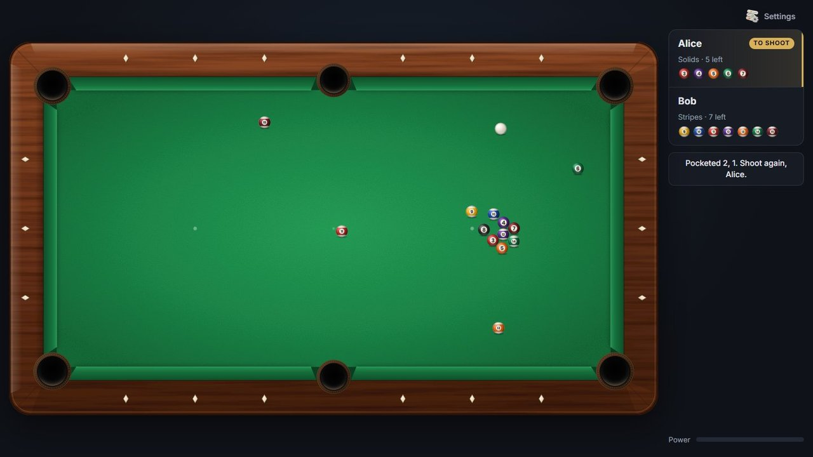

# Billiards

A two-player 8-ball pool game built on a physics engine written in C (`phylib.c`).

**Play it:** https://danieldombrovsky.com/billiards (direct link: https://billiards.danieldombrovsky9.workers.dev)




## Features

- **Real physics:** every shot is simulated by the same C engine, compiled to WebAssembly for the browser.
- **8-ball rules:** breaks, groups, fouls, scratches and the 8-ball finish are enforced for both players.
- **Play anywhere:** on one device, against the computer (easy, medium or hard), online with a friend using a 5-digit game code, or against a stranger with quick match. The computer tries the shots that line a ball up with a pocket using the same physics engine, and takes the one that plays best under the rules. Online shots are replayed on the other player's screen with the same physics.
- **Saved games:** every game, shot and resting table is stored. An unfinished game on this device can be resumed, and an online player who loses their seat can take it back with the code.
- **Three rule sets:** standard 8-Ball; Casual 8-Ball, where sinking the 8 early or scratching on it puts it back on the table instead of losing; and All Red, where every object ball is red and counts for whoever pockets it, and the first to 8 balls wins. The rules are chosen in Settings before a game, as is the table look.
- **Two looks:** a modern table with ball and cue artwork, or the classic look of the original Python version (a flat pale table with plain coloured balls), chosen in Settings on the home page or during a game. On a phone held upright, the table stands upright too. The browser also remembers your name.
- **Before the break:** choose who breaks, or flip a coin for it.
- **In a game:** a log of every shot, Start over, Resign and Leave, all from Settings.
- **Confetti** when someone wins.

There are two ways to run it.

## On the web (Cloudflare)

`web/` is a Cloudflare Worker with a D1 database. The browser runs `phylib.c` compiled to WebAssembly,
so every shot is simulated by the same C code. The Worker applies the 8-ball rules and saves each game,
shot and resting table in the same tables `Physics.py` uses (`web/schema.sql`).

- `web/public/` is the game: `index.html` (home), `play.html` (table), `engine.js` (runs the
  WebAssembly engine), `rules.js` (8-ball rules, also used by the Worker).
- `web/src/index.js` is the Worker: it serves `public/` and the `/api/games` routes.
- `web/wasm/phylib_wasm.c` exposes the few table functions the browser needs.

Running it on your machine needs Node 22:

```
cd web
npm install
npm run db:local   # creates the local database tables, once
npm run dev        # http://localhost:8787
```

After changing `phylib.c` or `phylib.h`, rebuild `web/public/phylib.wasm` with `sh web/build-wasm.sh`
(needs [wasi-sdk](https://github.com/WebAssembly/wasi-sdk)). To publish, run `npx wrangler deploy` from `web/`.

## Locally with Python

The original version: the C engine is wrapped for Python with SWIG and served by `server.py`. It needs
Linux (or WSL) with clang, SWIG and Python headers.

```
make PYTHONVER=python3.9          # use your Python version
export LD_LIBRARY_PATH=`pwd`
python3 server.py 3000            # http://localhost:3000
```

## Credits

Confetti uses [canvas-confetti](https://github.com/catdad/canvas-confetti) (ISC licence, see `CONFETTI-LICENSE.txt`).
