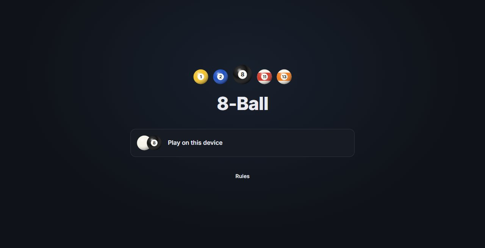

# Billiards

A two-player 8-ball pool game built on a physics engine written in C (`phylib.c`).

**Play it:** https://danieldombrovsky.com/billiards (direct link: https://billiards.danieldombrovsky9.workers.dev)




## Features

- **Real physics:** every shot is simulated by the same C engine, compiled to WebAssembly for the browser.
- **8-ball rules:** breaks, groups, fouls, scratches and the 8-ball finish are enforced for both players.
- **Saved games:** every game, shot and resting table is stored, and an unfinished game can be resumed.

There are two ways to run it.

## On the web (Cloudflare)

`web/` is a Cloudflare Worker with a D1 database. The browser runs `phylib.c` compiled to WebAssembly,
so every shot is simulated by the same C code. The Worker applies the 8-ball rules and saves each game,
shot and resting table in the same tables `Physics.py` uses (`web/schema.sql`).

- `web/public/` is the game: `index.html` (home), `play.html` (table), `engine.js` (runs the
  WebAssembly engine), `rules.js` (8-ball rules, also used by the Worker).
- `web/src/index.js` is the Worker: it serves `public/` and the `/api/games` routes.
- `web/wasm/phylib_wasm.c` exposes the few table functions the browser needs.

Running it on your machine needs Node 22:

```
cd web
npm install
npm run db:local   # creates the local database tables, once
npm run dev        # http://localhost:8787
```

After changing `phylib.c` or `phylib.h`, rebuild `web/public/phylib.wasm` with `sh web/build-wasm.sh`
(needs [wasi-sdk](https://github.com/WebAssembly/wasi-sdk)). To publish, run `npx wrangler deploy` from `web/`.

## Locally with Python

The original version: the C engine is wrapped for Python with SWIG and served by `server.py`. It needs
Linux (or WSL) with clang, SWIG and Python headers.

```
make PYTHONVER=python3.9          # use your Python version
export LD_LIBRARY_PATH=`pwd`
python3 server.py 3000            # http://localhost:3000
```
